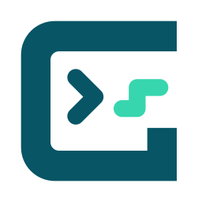

# Brooks GPL

Brooks/Precise Automation PA 제어기용 GPL(Guidance Programming Language) 프로젝트를 VS Code에서 제어기에 올리고, 컴파일·실행하고, 디버깅할 수 있는 확장입니다. 코드를 편하게 작성하도록 돕는 언어 기능도 함께 들어 있습니다.

취미로 틈틈이 개발하고 있어요. GPL로 작업하시는 분들께 조금이나마 도움이 되면 좋겠습니다. (＾▽＾)

## 주요 기능

| 기능 | 할 수 있는 일 |
| --- | --- |
| 업로드·컴파일·실행 | 소스 업로드(여러 프로젝트·참조 라이브러리 포함), 변경분 컴파일, 업로드 후 실행, Flash 영구 저장 |
| 디버깅 | 중단점, 단계 실행, 스레드·호출 스택·변수 확인, Watch 식 평가, 제어기에 있는 프로젝트에 바로 연결 |
| 제어기 모니터링 | 대시보드, 온도·메모리·에러 조회, 디지털 I/O, 런타임 콘솔·통신 로그 |
| AI 연동 | MCP 연결 설정 내보내기·점검, 진단 정보 공유, AI를 통한 배포·디버깅·상태 조회 |
| 프로젝트 관리 | `.gpr` 소스 목록 동기화, 라이브러리 의존 검사, 제어기 프로젝트 탐색·내려받기 |
| 코드 작성·탐색 | 구문 강조, 자동완성, 매개변수 도움말, 정의·참조 찾기, 이름 바꾸기 |

## 지원 환경

- **지원 파일:** `.gpl` 소스 파일과 `.gpr` 프로젝트 파일
- **제어기:** Brooks/Precise Automation PA 제어기의 명령 콘솔·런타임 콘솔·FTP 연동

제어기 업로드·컴파일·실행·디버깅에는 제어기와의 네트워크 연결이 필요합니다.
GPL 컴파일은 제어기에서 수행하며, 상태 조회 항목은 제어기 모델과 소프트웨어 버전·센서 구성에 따라 달라집니다.

## 시작하기

1. `Project.gpr`가 있는 폴더를 VS Code에서 엽니다. 프로젝트의 소스와 참조 라이브러리를 읽어 자동완성·정의로 이동·참조 찾기를 준비합니다.
2. VS Code 설정의 `gpl.controller.ip`에 연결할 제어기의 IP 주소를 입력합니다.
3. `GPL: Connect to Controller`를 실행합니다.
4. 사이드바의 **GPL Controller** 패널에서 스레드·파일·시스템 정보를 확인합니다.
5. 탐색기에서 `.gpr`가 있는 프로젝트 폴더를 우클릭해 `GPL: Upload & Start`(실행까지) 또는 `GPL: Debug Project`(디버깅)를 실행합니다.

확장에서 제공하는 명령은 명령 팔레트에서 `GPL:`을 검색하면 찾을 수 있습니다.
작업 영역에 프로젝트가 여러 개 있다면 명령을 실행할 때 작업할 프로젝트를 선택하면 됩니다.

## 업로드·컴파일·실행

소스만 올릴지, 컴파일하거나 실행할지에 따라 아래 명령을 선택해 주세요.

| 명령 | 동작 |
| --- | --- |
| `GPL: Upload Only` | 소스만 업로드합니다. 실행 중인 프로그램을 정지하거나 컴파일·실행하지 않습니다. 여러 프로젝트를 골라 차례로 올릴 수 있습니다. |
| `GPL: Quick Compile` | 변경된 소스를 업로드하고 컴파일합니다. 별도의 정지·실행 명령은 보내지 않습니다. |
| `GPL: Deploy` | 프로젝트를 업로드하고 컴파일합니다. 실행 중인 스레드의 정지가 필요하며, 프로그램은 시작하지 않습니다. |
| `GPL: Upload & Start` | 소스를 업로드하고 실행 중인 스레드를 정지한 뒤, 컴파일하고 실행합니다. |
| `GPL: Start` | 로컬 소스를 업로드하지 않고, 제어기에 있는 프로젝트를 컴파일하고 실행합니다. |
| `GPL: Save to Flash` | 프로젝트를 Flash에 영구 저장합니다. 전원을 끄지 말라는 표시가 사라질 때까지 기다려 주세요. |
| `GPL: Stop All Threads` | 모든 스레드의 정지를 요청하고, 진행 중이거나 대기 중인 업로드·배포도 취소합니다. |

- **참조 라이브러리 함께 올리기:** `.gpr`의 `ProjectLibrary`가 같은 projects 폴더의 다른 폴더(예: `projects/Main` → `projects/Libraries`)를 가리키면 그 라이브러리도 함께 올립니다(`gpl.deploy.uploadLibraries`). `ProjectStart`가 있는 상위 프로젝트 안의 하위 패키지(내장형)는 상위 프로젝트가 컴파일 단위이므로 그 라이브러리를 따로 올리지 않습니다.
- **컴파일 검증 필요:** `Upload Only`로 올렸거나 컴파일에 실패한 프로젝트는 상태 표시줄과 제어기 패널에 「컴파일 검증 필요」로 표시됩니다. 배지를 누르거나 `GPL: Quick Compile Unverified Projects`를 실행하면 프로젝트를 골라 차례로 컴파일할 수 있고, 항목의 ×로 컴파일 없이 목록에서 지울 수도 있습니다. `ProjectStart`가 없는 라이브러리는 단독으로 컴파일하지 않습니다. 그 라이브러리를 `ProjectLibrary`로 쓰는 실행 프로젝트가 컴파일에 성공하면 함께 해제되고, `/GPL`에서 폴더를 지워도 해제됩니다.
- **컴파일 오류:** 제어기가 알려 준 컴파일 오류는 **Problems** 패널에 표시되고, 오류가 난 위치로 바로 이동할 수 있습니다.
- **저장 시 자동 업로드:** 제어기에 연결한 상태에서 파일을 저장할 때 자동으로 업로드·컴파일할지는 `gpl.quickCompile.autoOnSave`에서 설정합니다. `auto` 모드에서는 저장한 소스를 업로드하되, 모든 스레드가 정지한 상태일 때만 컴파일합니다.
- **여유 메모리:** Compile·Start 전에 제어기의 여유 메모리가 부족하면 경고하고, 배포·Quick Compile 은 쓰레드를 정지한 뒤 로드된 실행 프로젝트를 Unload 해 메모리를 회수하고 진행합니다(`gpl.controller.memoryGuard.autoUnload`, 기본 켬). 자세한 내용은 `GPL: Show Controller Memory Status`로 보고, 쓰지 않는 프로젝트는 `GPL: Unload Project`로 메모리에서 내릴 수 있습니다. 기본은 `/GPL`을 비운 뒤 전부 내리는 `Unload -all`이고, 한 프로젝트만 내리려면 목록에서 고릅니다.
- **배포 전처리(메모리 절약):** `gpl.deploy.preprocess`를 켜면 워크스페이스 밖에 만든 사본을 올립니다. 주석·들여쓰기를 지우고(`stripComments`·`trimWhitespace`), 실행 프로젝트에서 이름으로 닿지 않는 라이브러리 파일은 올리지도 컴파일하지도 않으며(`excludeUnreachableLibraryFiles`), 남은 라이브러리 파일 안의 쓰지 않는 Sub·Function·Class·Const 같은 선언도 빈 줄로 바꿉니다(`removeUnusedMembers`). 늘 남길 파일·선언은 `keepFiles`에 적습니다. 줄 수를 그대로 지키므로 컴파일 오류 위치와 중단점은 원본과 같고, 로컬 파일과 Save to Flash 는 원본 그대로입니다. 프로젝트별로 켜려면 `projects`에 프로젝트 이름으로 적습니다.

제어기 파일 트리의 `Compile & Run`은 **제어기에 있는 소스**를 컴파일하고 실행합니다. PC에서 수정한 내용을 실행하려면 먼저 업로드해 주세요.

### `.gpr` 소스 목록과 의존 검사

제어기는 `.gpr`에 적힌 소스만 컴파일하므로, 프로젝트 폴더의 파일과 `.gpr` 목록을 맞춰 두는 것이 중요합니다.

- **소스 목록 동기화:** `.gpr` 파일을 우클릭해 `GPL: Sync Project Sources`를 실행하면 폴더의 파일에 맞춰 소스 목록을 정리합니다. 파일을 추가하거나 이름을 바꾸거나 삭제했을 때도 목록에 반영할지 확인합니다(`gpl.project.autoSyncSources`).
- **의존 검사:** `.gpr`를 열면(또는 우클릭 → `GPL: Check Project Dependencies`) 패키지마다 `ProjectLibrary`·`ProjectSource` 선언을 소스가 실제로 쓰는 파일과 대조합니다. 빠진 라이브러리·목록 누락은 Warning, 다른 라이브러리를 거쳐서만 들어오는 의존과 쓰지 않는 라이브러리는 Information으로 표시하고, Quick Fix로 줄을 더하거나 지울 수 있습니다.
- **계층 규칙:** 루트 `Project.gpr` 주석에 `' Dependencies: App -> Config/Gantry/Lib; Gantry -> Lib.`처럼 규칙을 적어 두면 규칙을 어긴 참조를 사용 위치에 표시합니다.

### 제어기 파일 탐색과 내려받기

`GPL: Browse Controller Files (제어기 FTP 폴더 연결)`을 실행하면 명령 콘솔 연결 없이 제어기의 FTP 폴더를 탐색할 수 있습니다.
폴더를 펼쳐 파일을 클릭하면 현재 창의 읽기 전용 편집기에서 열리며, 기존 작업 영역과 프로젝트는 그대로 유지됩니다.

제어기 파일 트리의 `Download`로 프로젝트를 내려받을 수도 있습니다.

- **Live Working Copy:** 내려받은 코드를 편집하고 제어기에 다시 반영하는 작업용 복사본입니다. 파일을 저장하면 자동 업로드 설정에 따라 처리합니다.
- **Read-only Snapshot:** 검토용 복사본입니다. 자동 업로드와 배포·컴파일·Flash 저장이 차단됩니다.

다운로드가 끝난 뒤 **Controller 작업공간 열기**를 선택하면 내려받은 프로젝트를 한 작업 영역에서 관리할 수 있습니다.

## 디버깅

### 디버깅 시작하기

- **배포하고 디버깅:** 프로젝트 폴더를 우클릭해 `GPL: Debug Project`를 실행합니다. `launch.json`을 직접 작성할 필요가 없습니다.
- **실행 중인 프로그램에 연결:** `GPL: Debug: Attach Only`를 실행합니다.
- **제어기에 있는 프로젝트를 바로 열기:** 제어기 파일 트리에서 프로젝트 폴더를 우클릭해 **Open Controller Project for Debugging (제어기 프로젝트 열어 디버깅)** 을 선택합니다. 명령 팔레트에서 같은 명령을 실행해 프로젝트를 고를 수도 있습니다.
- **디버그 설정 저장:** `GPL: Create/Update launch.json`으로 구성을 만든 뒤, 실행 및 디버그 화면에서 선택합니다.

### 디버거에서 할 수 있는 일

중단점과 단계 실행, 스레드별 호출 스택, 변수·배열·객체 조회, Watch 식 평가를 지원합니다.
특정 스레드를 고정해 두면 Continue·Step으로 조작할 대상을 유지할 수 있고, 에디터와 제어기의 중단점을 서로 맞추는 기능도 제공합니다.

디버거에서 **분리(Disconnect)** 명령을 실행해도 기본적으로 제어기의 프로그램은 계속 실행됩니다.
프로그램까지 정지하려면 디버그 툴바의 **Stop Debugging (디버그 중지 · 프로그램 정지)** 또는 `GPL: Stop All Threads`를 사용합니다.

참조 라이브러리의 소스에 중단점을 설정할 수 없다면 해당 `.gpl` 파일에서
`GPL: Promote Source for Breakpoint`를 실행해 메인 프로젝트의 소스로 포함할 수 있습니다. 변경 내용을 확인한 뒤 다시 배포해 주세요.

### 제어기에 있는 프로젝트 디버깅

**Open Controller Project for Debugging**은 PC에 소스가 없어도 제어기에 있는 프로젝트에 디버거를 연결합니다.

- 소스를 업로드하거나 컴파일·실행하지 않으며, 제어기의 기존 중단점도 그대로 둡니다. 연결 후 직접 추가한 중단점이나 Break·Continue·Step 조작은 제어기에 적용됩니다.
- `.gpr`와 라이브러리 관계를 먼저 확인하고, 파일을 열거나 디버거가 소스를 표시할 때 필요한 파일만 FTP로 읽습니다. 프로젝트 전체를 내려받거나 작업 영역을 바꾸지 않습니다.
- 읽어 온 파일은 세션 동안 TMP에 캐시하고, 열린 원격 문서와 디버그 세션이 모두 끝나면 정리합니다. 편집기 제목의 새로고침 버튼으로 원격 파일을 다시 읽을 수 있습니다.
- 원격 파일은 읽기 전용입니다. 개요·접기·완성·호버·정의 이동·시그니처 도움말은 제공하지만, 이름 바꾸기와 참조 전체 검색은 제공하지 않습니다. 함수 이름으로 중단점을 걸려면 해당 소스를 먼저 열어 주세요.
- 제어기에 저장된 FTP 소스와 현재 실행 중인 코드가 같은지는 따로 확인해 주세요. 내려받지 못한 라이브러리가 있으면 경고를 표시합니다.
- 현재 작업 영역을 신뢰한 상태여야 하며, 이미 진행 중인 GPL 디버그 세션이 있으면 먼저 분리해 주세요.

수정한 내용을 반영하려면 **Live Working Copy**로 내려받은 뒤 배포 기능을 사용해 주세요.

## 제어기 상태와 로그

제어기 패널과 `GPL: Open Controller Dashboard`에서 상태와 로그를 확인할 수 있습니다.

- **상태·자원:** 스레드, 전원, 메모리·자원 사용량과 오류 정보를 확인합니다.
- **축 위치:** 모든 로봇의 축을 막대 하나씩으로 보여 줍니다. 막대 양끝이 소프트 리밋이라 지금 어디쯤 있는지, 리밋에 가까운지, 움직이는 중인지 한눈에 보입니다.
- **추이:** CPU·앰프 온도, 여유 메모리, TCP 접속률, mbuf 여유를 같은 모양의 그래프로 한곳에 모아 보여 줍니다. 그래프에 마우스를 올리면 시각과 값이 나옵니다.
- **온도:** CPU·앰프 온도와 센서별 값, 조회 시각을 확인합니다. 지원하지 않는 센서와 확인하지 못한 값은 구분해서 표시합니다.
- **디지털 I/O:** 제어기 웹 화면처럼 Local I/O(Digital·Soft Internal·Dedicated)와 Remote I/O(RIO·Network Node)로 나눠 한 화면에 모아 보여 줍니다. 신호를 클릭하면 강제 토글, 더블클릭하면 강제 해제, 우클릭하면 강제 ON/OFF·그룹/전체 해제 메뉴가 열립니다.
- **런타임 콘솔:** 프로그램 출력과 실행 이벤트를 확인합니다.
- **통신 모니터·라이브 로그:** 명령 콘솔과 런타임 콘솔에서 주고받은 내용을 확인합니다.

`GPL: Open Digital I/O Panel`로 I/O 화면을 바로 열 수 있습니다.
통신 기록은 `GPL: Show Traffic Monitor`나 `GPL: Start Live Log Terminal`로 확인합니다.
문의를 남길 때는 `GPL: Copy Situation for Chat`으로 현재 상태를 복사해 첨부하면 도움이 됩니다.

## AI 에이전트 연동

MCP를 지원하는 AI 도구에서도 프로젝트 배포·디버깅·상태 조회 기능을 사용할 수 있습니다.
Claude Code나 Codex가 설치돼 있으면 확장이 MCP 서버를 사용자 설정에 한 번 등록할지 묻습니다(`GPL: Register AI Agent MCP`로 직접 등록할 수도 있습니다).
프로젝트 폴더에는 설정 파일을 만들지 않고, 제어기 주소는 확장의 현재 연결을 따르므로 IP가 바뀌어도 다시 설정할 필요가 없습니다.
설정이 잘 되었는지는 `GPL: Check AI Agent Setup`으로 점검하고, 예전 버전이 프로젝트에 만든 `.mcp.json`·CLAUDE.md 안내는 `GPL: Remove AI Agent Files from Workspace`로 정리할 수 있습니다.

AI 도구는 VS Code 확장과 같은 제어기 연결을 사용합니다. 주고받은 내용은 **GPL Language Support** 출력 채널에서 확인할 수 있습니다.

## 코드 작성과 탐색

| 기능 | 지원 내용 |
| --- | --- |
| 자동완성 | 프로젝트 심볼·멤버·로컬 변수, GPL 키워드·타입·연산자 |
| 매개변수 도움말 | 함수 호출 형식, 현재 입력 중인 매개변수, 오버로드별 정보 |
| Hover | 이름 위에 마우스를 올리면 타입·선언·함수 설명·매개변수·반환값 표시 |
| 정의로 이동 | 함수·클래스·변수의 선언 위치, 문자열로 지정한 `New Thread` 프로시저 |
| 참조 찾기 | 심볼을 사용하는 위치 검색 |
| 이름 바꾸기 | 선언과 사용 위치의 이름을 함께 바꾸고, 범위·예약어·이름 충돌 확인 |
| 심볼 탐색 | 현재 파일의 구조 확인, 프로젝트 심볼 검색 |

- **구문 강조·코드 접기:** 선언, 제어문, 주석과 영역을 구분하고 블록을 접을 수 있습니다.
- **코드 스니펫:** `If`, `For`, `Try`, `Select`, `Sub`, `Function` 등의 기본 구문을 빠르게 넣을 수 있습니다.
- **내장 API 도움말:** 주요 GPL 내장 API의 호출 형식과 설명을 확인하고 공식 레퍼런스로 이동할 수 있습니다.
- **문서화 주석:** 선언 위에서 `'''`을 입력하거나 `GPL: Insert Documentation Comment`를 실행하면 설명을 채워 넣을 주석이 만들어집니다. 작성한 내용은 Hover·자동완성·매개변수 도움말에 표시됩니다. 오버로드의 공통 설명은 한 번만 작성해도 함께 표시됩니다.
- **Requires 헤더:** 모듈 머리 주석에 `'Requires:` 블록을 두면, 이 파일이 쓰는 다른 파일의 Module·Class·멤버 목록을 정의 이동과 같은 기준으로 계산해 맞춥니다. 실제와 다르면 진단과 Quick Fix로 알려 주고(`gpl.requiresHeader.mode`를 `onSave`로 바꾸면 저장할 때 바로 고칩니다), `GPL: Update Requires Headers in Project`로 프로젝트 전체를 미리보기한 뒤 한 번에 갱신할 수 있습니다.
- **진단과 Quick Fix:** 문법·호환성 검사에서 찾은 문제와 수정 제안을 표시합니다.

## 주요 설정

VS Code 설정에서 `@ext:nir414.gpl-language-support`를 검색하면 확장 설정을 볼 수 있습니다.

| 설정 | 용도 |
| --- | --- |
| `gpl.controller.ip` | 제어기 IP 주소 |
| `gpl.controller.port` | 명령 콘솔 포트 |
| `gpl.controller.consolePort` | 런타임 콘솔 포트 |
| `gpl.quickCompile.autoOnSave` | 파일 저장 시 업로드·컴파일 방식 |
| `gpl.deploy.uploadLibraries` | 업로드할 때 형제 폴더의 참조 라이브러리도 함께 올릴지 여부 |
| `gpl.deploy.preprocess` | 배포 사본에서 주석·공백을 지우고 쓰지 않는 라이브러리 파일·선언을 빼서 제어기 메모리를 아낌(기본 꺼짐, 프로젝트별 설정 가능) |
| `gpl.project.autoSyncSources` | 소스 파일 변경 시 `.gpr` 목록 반영 방식 |
| `gpl.controller.memoryGuard.autoUnload` | 여유 메모리가 경고 기준 미만이면 배포 전에 정지 → Unload 로 회수하고 진행(기본 켬) |
| `gpl.controller.memoryGuard.confirmOnCritical` | 여유 메모리 심각 구간에서 Compile/Start 전 계속·취소 확인 |

이 밖의 설정과 기본값도 같은 화면에서 확인할 수 있습니다.

## 문제가 생겼을 때

| 증상 | 확인할 내용 |
| --- | --- |
| 제어기 연결 실패 | 제어기 주소, 명령 콘솔·런타임 콘솔·FTP의 네트워크 접근, 방화벽과 다른 프로그램의 접속 상태를 확인합니다. |
| PC가 절전에서 깨어난 뒤 연결이 끊김 | PC가 자는 동안 직결 네트워크가 내려간 것으로, 제어기 문제가 아닙니다(알림에 「PC 절전 복귀」로 표시됩니다). 네트워크가 다시 올라오면 알림의 「다시 연결」을 누르세요. 장비 작업 중에는 Windows 절전을 끄고, 직결용 USB 랜카드의 전원 절약(장치 관리자 → 전원 관리)을 해제해 두면 줄어듭니다. |
| 작업 중에 연결이 끊김 | 알림의 「사후 스냅샷 열기」에서 판정, 끊기기 직전에 보낸 명령, 도달성 결과를 확인합니다. 직결 케이블·USB 랜카드와, 같은 주소 대역을 쓰는 다른 네트워크(Wi-Fi 등)가 연결돼 있는지도 확인해 주세요. |
| 업로드·컴파일 실패 | **출력 → GPL Language Support**와 **GPL Deploy (Debug)** 출력 채널, **Problems** 패널에서 오류를 확인합니다. |
| 제어기에서 수정 전 코드가 실행됨 | `Start`는 로컬 소스를 업로드하지 않습니다. `Deploy` 또는 `Upload & Start`로 변경 사항을 먼저 반영합니다. 「컴파일 검증 필요」가 표시돼 있다면 아직 컴파일되지 않은 상태입니다. |
| 프로그램이 멈추지 않거나 Unload·Compile이 거부됨 | 다른 이름으로 띄운 스레드가 남아 있을 수 있습니다. `GPL: Stop All Threads`로 모두 정지하고, 그래도 남으면 `GPL: Diagnose Stuck Thread`로 원인을 확인합니다. |
| 자동완성·정의 찾기가 동작하지 않음 | 파일의 언어 모드가 GPL인지, `.gpr`의 소스·라이브러리 목록이 맞는지 확인하고 `GPL: Refresh Symbols`를 실행합니다. |

## 참고 자료와 문의

- [변경 이력](CHANGELOG.md) · [GitHub Releases](https://github.com/nir414/GPL_language/releases)
- [GPL 언어 시작하기](docs/gpl-language/getting-started.md) · [Project.gpr 형식](docs/reference/project-file-gpr.md)
- [제어기 상태·온도 조회 항목](docs/reference/controller-telemetry.md)
- [Brooks Automation 공식 GPL 레퍼런스](https://www2.brooksautomation.com/Controller_Software/Introduction_To_The_Software/Guidance_Programming_Language/)

사용하다가 불편한 점이 있거나 추가되면 좋을 기능이 떠오르면 [GitHub Issues](https://github.com/nir414/GPL_language/issues)에 편하게 남겨 주세요.
오류를 알려 주실 때는 확장 버전, 문제가 생긴 순서, 관련 로그를 함께 적어 주시면 확인하는 데 도움이 됩니다.

남겨 주시는 의견을 참고해 조금씩 다듬어 가겠습니다. 함께 써 주셔서 감사합니다! (•ᴗ•)
