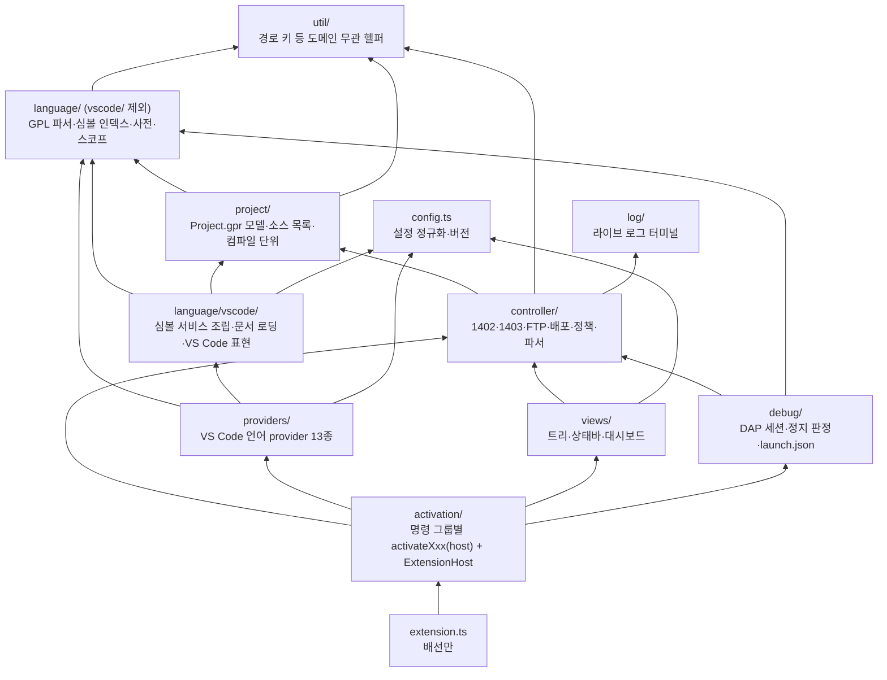
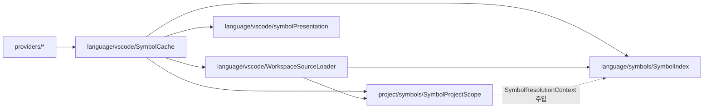

# 아키텍처 — 폴더가 계층을 말한다

> 이 문서는 **어디에 무엇을 두는가**와 **무엇이 무엇을 import 해도 되는가**의 정본이다.
> 같은 규칙을 `src/test/architecture.test.ts` 가 소스 트리를 읽어 검사하므로, `npm test` 가 통과하면
> 여기 적힌 구조가 실제 코드와 일치한다. 규칙을 바꾸려면 **테스트와 이 문서를 함께** 고친다.
> (2026-09-07 §1-DB 에서 정리. 세션별 변경 이력은 `docs/ai-handoff.md`, 파일별 한 줄 설명은 그 §4.)

## 1. 한 장 요약

확장은 두 축으로 나뉜다. **언어 축**(GPL 소스를 읽어 정의·참조·호버·완성을 만든다)과 **제어기 축**
(1402 명령 콘솔·1403 런타임 스트림·FTP 로 PA 제어기를 조작한다). 두 축 모두 **순수 계층**(vscode 를 모르는
Node 모듈)과 **접착 계층**(VS Code API 를 쓰는 모듈)으로 갈라진다. 순수 계층은 `npm test` 의 Node 단독
러너가 검증한다. VS Code 경계 일부는 모의 API로 자동 테스트하고, 실제 활성화·UI는 Extension Development Host(F5)에서 확인한다.

화살표는 "import 해도 되는 방향"이다. **아래 계층은 위 계층을 모른다** — `language/` 가 `controller/` 를,
`controller/` 가 `views/` 나 `activation/` 을 import 하면 테스트가 실패한다.

## 2. 계층 규칙

| 계층(폴더) | 역할 | import 가능 | vscode |
| --- | --- | --- | --- |
| `util/` | 어느 도메인에도 속하지 않는 순수 헬퍼 (`pathKey`·`formatBytes`) | — | 금지 |
| `language/` (`vscode/` 제외) | GPL 언어 분석·심볼 저장/조회 — 파서·문 사전·GPL Dictionary 데이터/조회·문서화 주석(+오버로드 병합)·분기형 getter 계산·스코프·이름 바꾸기 규칙·식별자 규칙·개요 표현 모델(`outlineModel`) | `util` | **금지** (전 모듈 순수) |
| `project/` | Project.gpr 모델 — 소스 목록·라이브러리 해석·컴파일 단위·소스 승격·.gpr 동기화 순수 로직 | `language`, `util` | 허용 목록 2개만 (`projectFileScope`·`promoteSourceCommand`) |
| `log/` | 1402/1403 트래픽 미러 터미널 | — | 허용 (단일 파일) |
| `config.ts` | 설정 값 정규화 단일 출처, `EXTENSION_VERSION` | `language` | 허용 |
| `controller/` | 제어기 축 — 소켓·명령 정책·응답 파서·배포 파이프라인(업로드 진행 집계 `uploadProgress` 포함)·잠금·중단점·상태 판정·AI 정책 | `project`, `util`, `log` | 허용 목록 9개만 (아래 §3) |
| `language/vscode/` | `SymbolCache` 조립·워크스페이스 소스 로딩·VS Code 완성/문서 표현 | `language`, `project`, `util`, `config` | 허용(접착 계층) |
| `debug/` | DAP 어댑터(`gplDebugSession`)·구성 provider·정지/스텝 판정·launch.json 편집 | `controller`, `project`, `language`, `util` | 허용 목록 2개만 |
| `views/` | 트리·상태바·대시보드와 그 표시 규칙 | `controller`, `util`, `config` | 허용 목록 3개만 |
| `providers/` | VS Code 언어 provider 구현 13종 + 공용 대응표(`symbolKinds`: 개요 분류 → `SymbolKind`, R7 정본) | `language`, `project`, `util`, `config`, `language/vscode` | 전부 허용(접착 계층) |
| `ai/` | AI 에이전트 설정 내보내기·점검. 대상 해석은 `controller/projects/projectTarget`, 경로 비교는 `util/pathKey` 사용 | `controller`, `util` | `exportAgentSetup`만 허용 (`agentSetupChecks`는 순수) |
| `activation/` | 명령 그룹별 `activateXxx(host)` + `ExtensionHost` + 공용 제어기 조작(`controllerOps`) | 위 전부 | 전부 허용(접착 계층) |
| `extension.ts` | `activate()`/`deactivate()` — 배선만(195줄) | 전부 | 허용 |
| `test/` | Node 단독 러너(`harness.ts`) + 순수 모듈 테스트 + 구조 테스트 | 전부 | **금지** (러너가 vscode 없이 돈다) |

같은 계층 안의 import 는 항상 허용된다. `import type` 도 방향 규칙을 따른다(설계상의 의존이므로) —
단 **런타임 순환 금지** 규칙(R3)에서는 지워지는 `import type` 을 제외한다.

### 2.1 controller 기능별 하위 모듈 (2026-10-22)

기술 계층의 의존 방향은 유지하면서, `controller/`의 파일 64개를 변경 이유가 같은 기능별로 묶었다.
하위 폴더는 탐색과 책임 분류의 경계다. 각 폴더의 독립적인 공개 API나 객체 수명주기는 아직 분리하지 않았다.

| 하위 폴더 | 책임 |
| --- | --- |
| `connection/` | 명령 연결·직렬 큐·keep-alive·세션·연결 건강·트래픽 본문 |
| `commands/` | 명령 정책·분류·Compile/Load/Unload/Start·스텝 명령 생성 |
| `protocol/` | 응답 파서·상태 코드·채널 이름 |
| `runtime/` | 런타임 콘솔 연결·버퍼·재연결 판정·표현 |
| `deployment/` | 배포·잠금·큐·취소·이력·출처 검증·Flash 안전·진행률 |
| `files/` | FTP·원격 폴더 정리·동기화 지문 |
| `projects/` | 제어기 대상 프로젝트·이름·원격 경로·선택·GPR 동기화 명령 |
| `threads/` | 쓰레드 인자·상태·보고서·정지 절차·진단·기동 후 관찰 |
| `debugging/` | 제어기 중단점 명령·에디터 동기화·디버그 이벤트·실행 표시 |
| `automation/` | Agent Bridge·AI 정책·복구 안내·작업 기록·URI 전달 |
| `diagnostics/` | 제어기 상태·메모리 검사·자원 프로브·에러 보고·최근 사건 |
| `io/` | 디지털 I/O 파싱·명령 |

`project/`는 로컬 Project.gpr와 소스 구성을, `controller/projects/`는 제어기 대상 선택과 조작을 맡는다.
`debug/`는 DAP 요청과 디버그 세션을, `controller/debugging/`는 제어기 측 중단점·동기화 프리미티브를 맡는다.
`controller/automation/`과 별도 프로세스인 `controller-mcp/` 사이의 파일 계약은 그대로 유지한다.

새 파일은 책임에 맞는 하위 폴더에 둔다. 필요하면 그 안을 더 나누며, 중첩 깊이를 고정하지 않는다.
구조 테스트 R9는 루트 재적재와 미분류 폴더를 막는다. 상위 계층 규칙(R2), vscode 허용 목록(R1),
런타임 순환 금지(R3), 판정 정본(R7)은 기존대로 적용한다. 하위 폴더 간 별도 의존 방향은 아직 강제하지 않는다.

### 2.2 언어 서비스의 객체 합성 (2026-10-22)

`SymbolIndex`는 정규화 경로별 심볼과 이름 인덱스를 소유한다. 프로젝트 경계·경로 순위는
`SymbolResolutionContext`로 받으므로 project 구현이나 vscode를 import하지 않는다.
`SymbolProjectScope`가 기존 CompileUnitIndex와 경로 점수 규칙을 소유한다.
`WorkspaceSourceLoader`는 미저장 버퍼 우선·인코딩·프로젝트 소스 탐색·배치 갱신·참조 텍스트 읽기를 맡는다.
`SymbolCache`는 기존 호출 계약과 refresh 수명주기·삭제 파일 정리·로그를 조립한다.
표현은 별도 상태가 없으므로 `symbolPresentation` 함수로 유지한다. 호스트의 조회 위임은 기존 Provider 계약을 보존하기 위한 경계다.

구조 테스트는 `language/vscode/`를 가장 구체적인 접착 계층으로 분류한다. 순수 language 모듈은
그 폴더나 project 구현을 import할 수 없고, 접착 계층에서만 project·config를 사용한다.
배치 중에는 파일별 심볼만 교체하고 종료 시 이름 인덱스를 한 번 재구축하는 기존 시점을 유지한다.
파일 읽기는 인덱스의 갱신 번호를 예약한 뒤 실행하며, 문서 변경·삭제·clear 또는 더 최신 읽기가 있으면 결과를 버린다.
refresh는 직렬 실행하고 진행 중 추가 요청을 후속 갱신으로 합친다. 참조 검색도 로더의 공통 인코딩·문서 버퍼 경로를 사용한다.

파일 이동 뒤 TypeScript가 남기는 이전 JS·소스맵은 `npm run compile`의 `scripts/prune-build-outputs.js`가
현재 tsconfig 출력 목록과 대조해 제거한다. VSIX에 옛 경로의 구현이 다시 섞이는 것을 막고 별도 MCP 번들·리소스는 보존한다.

### 2.3 객체 책임 분리의 다음 단계

방향은 도메인별 모듈화와 객체 합성이다. 상태·자원·수명주기를 소유하는 객체를 먼저 구분하고,
파싱·판정 같은 순수 함수는 유지한다. 호출 한 줄을 옮기는 위임 래퍼나 깊은 상속 계층은 만들지 않는다.
완료 표시가 없는 단계의 객체 이름은 설계 후보이며 아직 구현하지 않았다.

1. **완료 — controller 폴더 분류**: 파일 이동·import·문서·구조 검사만 변경하고 실행 로직을 보존한다.
2. **완료 — 언어 인덱스 분리**: `language/symbols/SymbolIndex`가 심볼을, `project/symbols/SymbolProjectScope`가 프로젝트 경계를 소유한다.
   `language/vscode/`는 기존 `SymbolCache` API를 조립하고 문서 로딩·표현을 담당한다. Provider 등록 위치는 다음 접착 계층 단계에서 정리한다.
3. **디버그 객체 합성**: `GPLDebugSession`은 DAP 경계를 유지하고 중단점·변수·실행 제어·폴링을 책임 객체로 분리한다.
4. **연결·배포 소유권 분리**: `ControllerSession`이 기존 단일 명령 큐와 연결 수명주기를 소유하고,
   `DeploymentService`는 계획·단계 실행·취소를 맡는다. 공유 세션과 잠금·안전 정책을 그대로 재사용한다.
5. **접착 계층 재배치**: 언어 Provider·UI·자동화 등록을 소유 기능 가까이 모으고 `ExtensionHost`를 조립 중심으로 줄인다.

각 단계는 별도 diff로 검토하고 컴파일·단위/구조 테스트·VSIX 패키징까지 끝낸다. 연결·배포·디버그의
실행 순서나 수명주기를 바꾸는 단계는 안전한 시험 조건에서 F5 및 제어기 검증을 별도로 진행한다.

## 3. vscode 를 import 해도 되는 순수-계층 모듈 (허용 목록)

접착 계층(`activation/`·`providers/`·`language/vscode/`) 밖에서 vscode 를 쓰는 모듈은 아래와 **정확히 일치**해야 한다.
새로 넣으려면 여기와 `architecture.test.ts` 의 `VSCODE_ALLOWED_MODULES` 에 함께 적는다.

| 모듈 | 왜 vscode 가 필요한가 |
| --- | --- |
| `controller/connection/controllerConnection` | 설정 읽기(`workspace.getConfiguration`)·Output 채널 — 순수 소켓 계층은 `consoleSocket` 에 있다 |
| `controller/runtime/runtimeConsole` | 1403 스트림의 Output 채널·Disposable — 재연결 상태 머신 분리는 로드맵 Phase 3 |
| `controller/deployment/deployService` | 배포 파이프라인이 Problems(DiagnosticCollection)·Output 을 직접 받는다 — 결과 보고부는 `deployOutcome`(순수)로 분리됨 |
| `controller/deployment/deployRecord` | `deployRecordCore`(순수)의 Memento 래퍼 |
| `controller/debugging/debugBridge` | 디버그 세션 ↔ 확장 이벤트 버스(`EventEmitter`) |
| `controller/debugging/breakpointSync` · `breakpointMirror` | 에디터 중단점(`debug.breakpoints`) 양방향 동기화 — 계획 계산은 `breakpointReconcile`(순수) |
| `controller/projects/projectPicker` · `gprSyncCommand` | QuickPick·WorkspaceEdit 를 쓰는 명령 래퍼 — 규칙은 `projectPickerCore`·`project/gprSync`(순수) |
| `debug/gplDebugSession` · `activateDebug` | DAP 세션 자체(`vscode.debug`)·구성 provider |
| `project/projectFileScope` · `promoteSourceCommand` | `workspace.findFiles`·명령 등록 |
| `views/*` 3개 | TreeDataProvider·StatusBarItem·WebviewPanel — 표시 규칙은 `treeFormat`·`runtimeConsoleTreePresentation`·`refreshThrottle`·`compileStaleBadge`·`uploadProgressBar`(순수) |
| `ai/exportAgentSetup` · `log/liveLogTerminal` | 파일 대화상자·터미널 |
| `config` · `extension` | 루트 모듈 |

원칙: **판단은 순수 모듈에, vscode 호출은 얇은 래퍼에.** 새 기능을 넣을 때 "이 판단을 Node 단독 테스트로
고정할 수 있는가"를 먼저 묻고, 그렇다면 순수 모듈로 쓴 뒤 접착 계층에서 부른다(예: `startCommand`·
`commandPolicy`·`breakpointReconcile`·`deployOutcome`).

### 3.1 제어기 조작은 "절차"를 모듈로 (주입형 IO)

제어기(1402)의 원시 명령은 **안전한 단위가 아니다.** 예를 들어 `Stop -all` 은 정지 *요청 접수*까지만 보장하고
(§0.6), 실제 정지는 `Show Thread` 폴링으로 확인해야 하며, `-752` 는 실패가 아니라 진행 중이고, 안 멈추면
재시도해야 한다. 즉 **"프로그램을 멈춘다"는 한 동작 = 전송 + STATUS 판정 + 확인 폴링 + 재시도 + 실패 처리** 전부다.

그래서 이런 절차는 호출부에서 조립하지 않고 `controller/` 의 순수 모듈에 **절차째로** 둔다. 호출부가 다른 것은
전송 수단과 로그 목적지뿐이므로 그것만 IO 인터페이스로 주입한다(`send`/`log`/`sleep`/`isCancelled`/`now`).
그러면 ① 가짜 IO 로 시나리오를 Node 단독 테스트에 고정할 수 있고 ② 판정 규칙이 바뀌어도 한 곳만 고치면 되며
③ 새 호출부가 안전장치를 빠뜨릴 수 없다(실제로 디버그 세션의 attach preflight 는 정지 확인이 빠져 있었다).

정본: `controller/threads/threadStop.ts`(전체·개별 쓰레드 정지) · `controller/commands/projectCommands.ts`(Compile/Load/Unload/Start) ·
`controller/projects/remoteProjectPath.ts`(어느 원격 사본을 대상으로 삼을지) ·
`controller/threads/threadStuckDiagnosis.ts`(정지 불가 쓰레드 진단 — **상태를 바꾸지 않는** 읽기 전용 절차. 원시 명령 위에
얹는 겹은 같지만 결과가 "조치"가 아니라 **근거와 후보**다. 실행 여부는 사람이 고른다). 결과는 성공/실패 불리언이 아니라 **구조화된 결과**로
돌려주고, 특히 "확인하지 못함"(`unconfirmed`)을 성공과 구분해 드러낸다 — 배포는 통과시키고 원격 파일 삭제는
중단하는 식으로 **정책은 호출부가 고른다.** 같은 꼴로 정리할 다음 후보(`Show Thread` 열거·중단점 명령 폴백·busy 재시도·스택 조회)는
`docs/ai-handoff.md` §1-DD 의 표와 §1-DE 말미에 있다.

### 3.2 용어 — 이 구조를 부르는 표준 이름

여기서 한 일에는 업계 표준 명칭이 있다. 검색·문서화·외부 자료 대조를 위해 **영문 원어를 함께** 적어 둔다
(한국어 번역이 갈리는 항목은 표 아래에 밝혔다). 저장소 문서·주석은 이 표기를 쓴다.

| 용어 | 이 저장소에서 무엇을 가리키나 |
| --- | --- |
| 손상 방지 계층 (ACL, Anti-Corruption Layer) | 제어기(1402)의 부실한 원시 명령을 우리 도메인 언어로 감싸는 `controller/` 절차 모듈들. **§3.1 이 말하는 것이 이것이다** |
| 단일 진실 공급원 (SSOT, Single Source of Truth) | 이 저장소에서 "정본"이라고 쓰는 것 — 판정 규칙이 사는 단 한 곳 |
| 중복 배제 원칙 (DRY, Don't Repeat Yourself) | 위를 요구하는 원칙 |
| 의존성 주입 (DI, Dependency Injection) | `send`/`log`/`sleep` 을 호출부가 넣어 주는 IO 인터페이스 |
| 포트와 어댑터 (Ports and Adapters) | 순수 계층이 정의한 인터페이스(포트) ↔ vscode·소켓 구현(어댑터)의 분리 |
| 육각형 아키텍처 (Hexagonal Architecture) | 위 원칙을 아키텍처 전체에 적용한 형태 — §2 계층표가 그 그림이다 |
| 퍼사드 패턴 (Facade Pattern) | 여러 단계(전송·판정·폴링·재시도)를 호출 하나로 감춘 형태 |
| 중복 구현 통합 (Code Consolidation) | 흩어진 사본을 정본 하나로 모으는 작업 자체(§1-DD·§1-DE) |
| 구현 편차 (Implementation Drift) | 사본들이 시간이 지나며 조금씩 달라진 상태 — "이 기능 저 기능이 다르게 동작한다"의 정체 |
| 메커니즘과 정책의 분리 (Separation of Mechanism and Policy) | 모듈은 관측 결과(`unconfirmed` 등)만 돌려주고, 그걸로 무엇을 할지는 호출부가 정하는 규약 |
| 험블 오브젝트 패턴 (Humble Object Pattern) | vscode 의존을 테스트 불가능한 얇은 껍질로 몰아내는 방식(`deployService` 의 UI 부분) |

> **번역이 갈리는 항목**: Anti-Corruption Layer 는 Microsoft Learn 이 **손상 방지 계층**, 에릭 에반스 DDD
> 번역서 계열이 **부패 방지 계층**을 쓴다. 이 저장소는 **손상 방지 계층**으로 통일한다.
> Single Source of Truth 도 *단일 진실 원천*·*단일 정보원* 표기가 있으나 위 표기를 쓴다.

### 3.2.1 이 용어들은 표어가 아니라 **검사 대상**이다

위 표의 원칙 중 계층으로 표현되는 것(육각형 아키텍처·포트와 어댑터·험블 오브젝트)은 구조 테스트
R1·R2·R3 이 이미 강제한다. 그러나 **단일 진실 공급원(SSOT, Single Source of Truth)** 과
**중복 배제 원칙(DRY, Don't Repeat Yourself)** 은 계층을 지켜도 무너진다 — 같은 판단을 여러 모듈이
각자 구현하면 폴더 규칙은 하나도 어기지 않으면서 구현 편차(Implementation Drift)가 생긴다.
실제로 그렇게 됐다: 수신자 타입 해석은 `language/receiverType.ts` 가 정본인데 완성 provider 는
자체 구현을 들고 있다가 `Thread.CurrentThread().` 뒤를 해석하지 못했고(§1-DO), 배열 요소 타입을
벗기는 규칙은 사본이 네 벌이었다.

그래서 **"이 판단의 정본은 어디"를 표로 두고 구조 테스트 R7 이 우회를 잡는다**
(`src/test/architecture.test.ts` 의 `SSOT_RULES`).

| 판단 | 정본 | 우회 표식(R7 이 잡는 것) |
| --- | --- | --- |
| 파일별 심볼의 이름 인덱스 | `language/symbols/symbolIndex.ts` (`SymbolIndex`), 조립 함수는 `language/symbolNameIndex.ts` | `buildSymbolNameIndex(` 직접 호출 |
| 수신자 체인 → 타입/홀더 | `language/receiverType.ts` (순수) | — |
| 그 해석기에 넘길 컨텍스트 조립 | `providers/receiverContext.ts` (vscode 접착) | `buildDocumentReceiverLookup(` 직접 호출 |
| 배열 표기·요소 타입 | `language/receiverType.ts` (`elementTypeOf`·`isArrayTypeName`) | `replace(/\[\]$/…)` |
| "컴파일 검증 필요" 상태의 설명 문장(배지 툴팁·Start 확인 모달·자동화 오류) | `controller/deployment/compileStale.ts` (`describeCompileStale`) — 배지 라벨·툴팁·클릭 대상은 `views/compileStaleBadge.ts` | `소스가 아직 Compile 로 검증되지 않았습니다` 직접 조립 |
| 쓰레드 목록 표·상태 집계(「전체 쓰레드 복사」·상황 스냅샷) | `controller/threads/threadReport.ts` (`renderThreadTable`·`countThreadStates`·`summarizeThreadStates`) | `\| 이름 \| 상태 \|` 표 직접 조립 / `state === 'Paused' \|\| … 'Break'` |
| 에러 코드 → 코드/환경 분류(트리 버킷·오류 상세·배포 요약) | `controller/protocol/responseParser.ts` (`classifyErrorEntry`·`describeErrorCategory`·`getGplErrorGroup`) | `category: 'code'/'environment'` 직접 판정 |
| 바이트 → 사람이 읽는 크기(트리 FTP 목록·업로드 진행 바·완료 요약) | `util/formatBytes.ts` (`formatBytes`·`formatBytesAs`·`byteUnitFor`) | `.toFixed(1)} KB/MB/GB` 직접 조립 |
| 업로드 진행 바·완료 요약 문구(상태바 본문·툴팁·완료 표시) | `views/uploadProgressBar.ts` (`renderBar`·`renderUploadProgress`·`renderUploadSummary`) — 집계는 `controller/deployment/uploadProgress.ts` | 블록 글자(`█░`)로 바 직접 그리기 / 상태바 `업로드 완료 — 변경 없음`·크기 템플릿 직접 조립 |
| Flash 쓰기 전원 차단 금지 문구(쓰기·`Sync`·10초 안정화·안전 미확인) | `views/flashSafetyPresentation.ts` (`presentFlashSafety`) — 절차·시간은 `controller/deployment/flashSafety.ts` | `FLASH 저장 중`·`FLASH 안전 상태 미확인` 직접 조립 |

새 정본을 세우면 `SSOT_RULES` 에 한 줄을 더한다(무엇을·정본은 어디·우회 표식·대신 쓸 것).
규칙을 늘리는 비용이 낮아야 실제로 늘어난다.

**의존성 주입(DI, Dependency Injection)** 도 같은 방식으로 읽는다: `receiverContext` 는
`SymbolCache` 를 import 하지 않고 이름 조회 함수만 받는다 — `controller/` 절차 모듈이
`send`/`log`/`sleep` 을 받는 것과 같은 규약이고, 그래서 테스트 대역으로 갈아끼울 수 있다.

### 3.3 프로세스 간 조정은 `%TEMP%` 파일 계약으로

이 확장의 자동화는 **한 프로세스 안에서 끝나지 않는다.** VS Code 창이 여럿일 수 있고, MCP 서버
(`controller-mcp`)는 별도 node 프로세스이며, 제어기는 단일 클라이언트다. 그래서 "누가 지금 업로드
중인가", "어느 창에 명령을 보내야 하나", "그 배포는 끝났나" 같은 것을 **프로세스 밖에서 볼 수 있는
파일**로 조정한다. 새 포트·서버·의존성을 만들지 않는 것이 이 선택의 이유다.

| 경로 (`%TEMP%/gpl-controller/`) | 정본 모듈 | 무엇을 조정하나 |
| --- | --- | --- |
| `<ip>.lock.json` | `controller/deployment/deployLock.ts` | 업로드/배포 크리티컬 섹션의 상호 배제 — 끝나면 **사라진다** |
| `extensions/<instanceId>.json` | `controller/automation/agentBridge.ts` | 살아 있는 확장 인스턴스(창) 목록 — 어느 창인지·무슨 워크스페이스인지 |
| `bridge/inst/<instanceId>/{req,res}` | `controller/automation/agentBridge.ts` | MCP → 그 창의 명령 요청/응답 |
| `<ip>.extension.json` · `bridge/<ip>/…` | `controller/automation/agentBridge.ts` | 위의 **레거시(IP) 경로** — 리더 인스턴스 하나만 서비스(구버전 MCP 호환) |
| `operations/<operationId>.json` | `controller/automation/operationStore.ts` | 장시간 작업의 단계와 **결과** — 끝난 뒤에도 **남는다** |
| `cancellations/<operationId>.json` | `controller/deployment/deployCancellation.ts` | 명시적 전체 정지를 실행 중·대기 중 업로드/배포에 전달 — 작업이 끝나면 **사라진다** |

지켜야 할 규약:

1. **각 계약의 정본 모듈은 하나**이고, MCP 쪽 구현(`controller-mcp/src/{deployLock,deployCancellation,extensionBridge,operations}.js`)은
   그 파일 머리말에 적힌 계약을 **읽기 전용으로 미러**한다. 필드를 늘릴 때 양쪽 머리말을 같이 고친다.
2. **읽는 쪽은 모르는 필드를 무시하고 version 을 튕기지 않는다.** 그래서 필드 추가는 구버전과 섞여도
   안전하다(배포 잠금 v1→v2 가 그 예다). 반대로 필드의 *의미*를 바꾸는 것은 호환을 깨는 변경이다.
3. **쓰기는 임시 파일 + rename**(원자적)으로 하고, 지우는 것은 **자기 레코드일 때만** 확인 후 지운다 —
   뒤늦은 `finally` 가 새 보유자를 지우면 상호 배제가 무너진다.
4. **"살아 있음"은 heartbeat + pid 로 판정한다.** 그리고 그 판정은 **읽는 쪽이** 하고 파일을 고치지 않는다.
   진행 중이라고 적혀 있는데 신호가 끊긴 것은 `UNKNOWN`(결과 미확정)이며 **실패가 아니다**(§0 하드 규칙 3).
5. **이 파일들은 로그가 아니라 조정/조회 프리미티브다.** 제어기의 상태 판단에는 쓰지 않는다 —
   그것은 여전히 1402 `<STATUS>` 와 1403 스트림만이 답한다(§0 하드 규칙 1과 충돌하지 않는 이유).
6. 여러 창이 같은 자원을 볼 때 **임의로 하나를 고르지 않는다.** 대상이 좁혀지지 않으면 후보를 담은
   구조화 오류(`EXTENSION_AMBIGUOUS` 등)를 돌려주고, 고정이 필요한 경우에만 **계산으로 정한 리더**를 쓴다
   (`electLeaderInstanceId` — 확장과 MCP 가 같은 규칙이라 같은 답을 낸다).

오류 응답의 "그래서 무엇을 하면 되는가"는 `controller/automation/automationRecovery.ts` 표가 정본이다 —
코드마다 `action`·`retryCurrentCommand`·`safeToRepeat` 를 고정하고, **표에 없는 코드는 재시도 금지**로
떨어진다. 배포가 실제로 무엇을 올렸는지는 `controller/deployment/deployProvenance.ts` 가 지문 대조로 답한다.

## 4. 조립 — extension.ts → ExtensionHost → activation/*

- `extension.ts` 는 `ExtensionHost` 를 만들고 `activateXxx(host)` 를 **종전 순서대로** 부른다. 순서가 뜻을
  갖는 지점은 그 파일 머리말에 있다(트리·프로젝트 컨텍스트가 먼저, 언어 기능 마무리는 맨 끝).
- `activation/host.ts` 의 `ExtensionHost` 는 종전 5,300줄 클로저가 공유하던 것을 명시적으로 담는다:
  서비스(불변) · 가변 상태(항상 `host.x` 로 읽는다) · 두 그룹 이상이 쓰는 헬퍼 · 하위 API(`project`·`connection`·
  `deploy`·`decorations`). 새 명령은 해당 그룹 파일에 추가하고, 그룹이 없으면 `activateXxx(host)` 하나를 더 만든다.
- 명령 ID·설정 키는 `package.json` 이 정본이다. 구조 테스트 R5/R6 이 "선언됐는데 등록 안 됨", "코드가 읽는데
  선언 안 됨"을 잡는다. 명령 ID 를 상수로 두는 경우(`GPR_SYNC_COMMAND` 등)도 인식한다.

## 5. 어디에 무엇을 두나 (판단 기준)

| 넣으려는 것 | 위치 |
| --- | --- |
| GPL 문법·의미 규칙과 심볼 저장/조회 | `language/` (`vscode/` 제외) — vscode 금지 |
| 언어 서비스 조립·문서/디스크 로딩·VS Code 표현 | `language/vscode/` |
| 심볼 후보의 프로젝트 경계·경로 우선순위 | `project/symbols/` |
| Project.gpr·소스 파일 목록·프로젝트 경계 | `project/` |
| 1402/1403/FTP 프로토콜, 응답 파서, 명령 정책, 배포 단계 판정, 상태 코드 | `controller/` (순수로 쓸 수 있으면 순수로) |
| DAP 요청 처리, 정지/스텝 판정 | `debug/` |
| 트리/상태바/대시보드에 **어떻게 보이는가** | `views/` — 문구·아이콘 규칙은 순수 모듈로 |
| VS Code provider(hover·completion…) | `providers/` — 판단은 순수 `language/`와 `language/vscode/SymbolCache`에서 가져온다 |
| 명령 등록, 알림, QuickPick, 설정 읽기 | `activation/` |
| 어느 도메인에도 속하지 않는 헬퍼 | `util/` (도메인 규칙은 넣지 않는다) |
| 설정 값 정규화 | `config.ts` (`pickOption` 패턴 — 허용값 목록 하나로 기본값·정규화를 같이 관리) |

파일 스타일: `.ts` 는 폴더마다 탭(activation·views·controller 일부)과 공백 4칸이 섞여 있다. **이웃 파일을 따른다.**
저장소 EOL 은 LF 지만 `core.autocrlf=true` 라 작업 트리엔 CRLF 파일이 섞여 있다 — 스크립트로 고칠 때는
파일별 EOL 을 보존한다(`.editorconfig` 참조).

## 6. 테스트 전략

- **러너**: `src/test/harness.ts`(의존성 0) + `src/test/index.ts`(수동 등록). `npm test` = `tsc` + `node out/test/index.js`.
  새 테스트 파일은 `index.ts` 에 한 줄 import — 잊으면 구조 테스트 R4 가 실패한다.
- **대상**: 순수 모듈 전부(2026-09-07 기준 820건). vscode 를 import 하는 모듈은 이 러너로 못 돈다 — 그래서
  판단 로직을 순수 모듈로 빼는 것이 곧 테스트 가능성이다.
- **구조 테스트** `architecture.test.ts` (9건): R1 vscode 허용 목록 · R2 계층 방향 · R3 런타임 순환 · R4 테스트 등록 ·
  R5 package.json↔명령 · R6 package.json↔설정 키 · **R7 판정 정본(SSOT) 우회 금지**(§3.2.1) · R8 채널 이름 · R9 controller 기능 분류.
  실패 메시지가 위반 목록을 그대로 보여 준다.
- **컴파일러 게이트**(tsconfig): `strict` + `noUnusedLocals` · `noUnusedParameters` · `noImplicitReturns` ·
  `noImplicitOverride` · `noFallthroughCasesInSwitch`. 쓰지 않는 매개변수는 `_` 접두.
- **하드웨어 검증이 필요한 것**은 코드로 강제하지 않고 `docs/ai-handoff.md` §3 체크리스트로 남긴다(하드 규칙 6).

## 7. 알고 있는 부채 (2026-10-22 소스 기준)

| 항목 | 크기 | 상태 |
| --- | --- | --- |
| `debug/gplDebugSession.ts` | 약 5,460줄, 클래스 1개 | DAP + 제어기 동작이 한 클래스 — 분해는 실기기 검증 필요(로드맵 P8) |
| `controller/deployment/deployService.ts` `deployLocked` | 1,100줄 함수 | 배포 파이프라인 단계 분리는 하드웨어 영향(로드맵 P9) |
| `controller/runtime/runtimeConsole.ts` | 약 1,368줄 | 재연결 상태 머신 → 명시적 상태 머신(로드맵 Phase 3) |
| `views/controllerTreeProvider.ts` | 약 1,605줄 | 포맷 함수는 분리됨. 섹션별 노드 생성 분리는 후보 |
| `activation/deploy.ts` | 약 1,344줄 | 결과 보고부 분리됨. 자동화 게이트·명령 6개가 남아 있다 |
| 1403 상태 문구 두 표현 | `controller/runtime/runtimeConsolePresentation`(알림, 영문) vs `views/runtimeConsoleTreePresentation`(트리, 한국어) | 폴링 판정 정규식이 다르다 — 실기기 문구 대조 후 통일 결정 |
| provider 별 수신자 해석 사본 | definition·hover·완성·디버그 hover | **정리됨(2026-09-10)** — 해석은 `language/receiverType`, 조립은 `providers/receiverContext` 하나로. R7 이 재발을 막는다 |
| `config.ts` 안의 언어 헬퍼 | `getQualifiedWordAtPosition`·`isInCommentOrString`·`GPL_CONTROL_KEYWORDS` | `language/` 로 옮길 후보(`ciEq` 는 옮겼다) |
| `SymbolCache` 책임 혼합 | 인덱스·프로젝트 범위·호스트·소스 로더·표현을 독립 모듈로 구성 | **분리 완료(2026-10-22)** — 공개 메서드 28개 유지, 별도 루트 호환 래퍼 없이 내부 import 이동 |
| `controller-mcp/src/index.js` | 약 2,351줄 | MCP 서버 도구 정의 한 파일 — 별도 하위 프로젝트, 테스트 137건 |

## 8. 관련 문서

- 세션 이력·하드 규칙·다음 할 일: `docs/ai-handoff.md` (§0·§3·§4)
- 설계 원칙(명확성 > 간결성, 테스트 가능성 > 편리성, thin wrapper 지양): [design-principles](design-principles.md)
- 장기 방향(브로커 프로세스 분리) — 이 문서의 계층은 그 Phase 0(코어 디커플링)의 현재 상태다: [broker-workbench-architecture](broker-workbench-architecture.md)
- 제어기 디버깅 절차: [ai-controller-debugging-runbook](ai-controller-debugging-runbook.md)

### 메모리 사전 검사

`controller/diagnostics/memoryGuard.ts`는 Show Memory의 종결 STATUS와 Free 값을 해석하고 정책을 판정하는 순수 모듈입니다. `controllerConnection`은 Compile/Start를 보내기 직전 같은 직렬 큐 슬롯에서 검사하고, `deployService`는 업로드 전에 추가 검사합니다. `memoryGuard.warnMb`(기본 4 MB)·`blockMb`(기본 2.5 MB)는 현장 보고 기반의 설정 가능한 운영 기준입니다. 알 수 없는 측정은 정상으로 간주하지 않습니다. 삭제·Unload·재시도는 자동 수행하지 않습니다. Upload Only와 구형 MCP 직접 TCP 경로는 이 검사 대상이 아닙니다. MCP는 Export의 `GPL_BRIDGE=only` 경로를 사용합니다. 업로드 바이트로 미래 Free를 추정하는 기능과 원격 재귀 크기 집계는 아직 없습니다.

### FTP 원격 소스 보기

`controller/files/remoteSourceSession`은 VS Code를 참조하지 않고 FTP 메타데이터, 세션별 TMP 캐시와 원격 경로/URI 매핑을 소유한다. `activation/controllerRemoteFiles`가 읽기 전용 FileSystemProvider와 문서·DAP 세션의 수명을 연결하고, `activation/controllerProjectDebug`는 기존 작업공간을 유지한 채 Attach 구성을 전달한다. DAP는 명시한 원격 세션의 소스만 사용한다. `activation/controllerSourceLanguage`는 현재 열린 원격 문서를 별도 SymbolCache에 넣어 로컬 작업공간과 다른 원격 프로젝트의 심볼이 섞이지 않게 한다.
